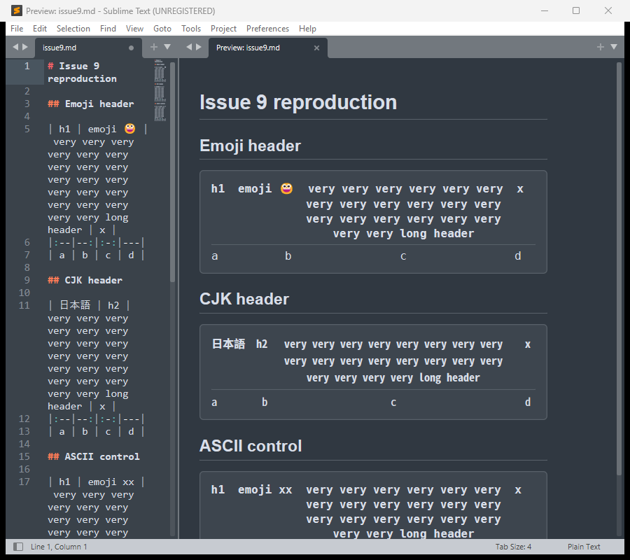
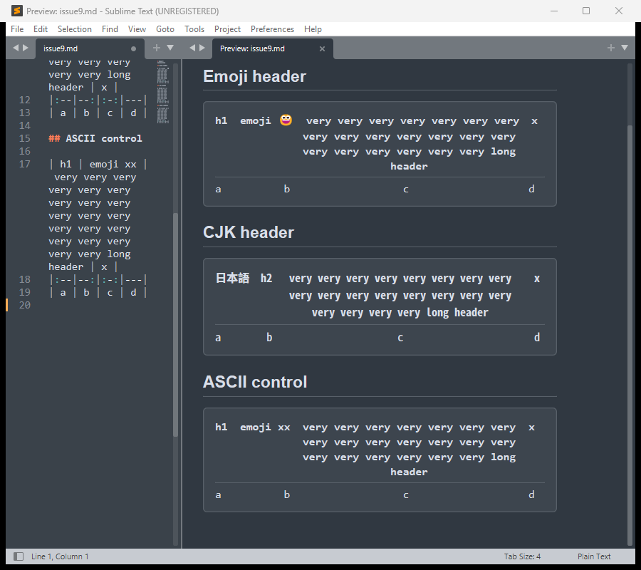

# Branch notes: measure the table font advance instead of assuming it

**Branch:** `fix/measured-mono-advance`, based on `590bcc0` (Release 0.7.0).
**Not a formal pull request yet** — this file is the write-up, committed to the
branch so it can be read from GitHub alongside the code.

## Links

- Branch: <https://github.com/dpc00/MarkdownGlance/tree/fix/measured-mono-advance>
- This file: <https://github.com/dpc00/MarkdownGlance/blob/fix/measured-mono-advance/BRANCH-NOTES.md>
- Diff against `feibuilds/main`:
  <https://github.com/feibuilds/MarkdownGlance/compare/main...dpc00:fix/measured-mono-advance>

## Why

`tables.budgets()` turns the preview's pixel width into a column count, and
`measure.outline_width_px()` turns columns back into pixels. Both used
`LATIN_ADVANCE = 0.6023`, measured on Linux for DejaVu Sans Mono, on the
reasoning in ADR 0007 that the renderer cannot query the font.

That is exact when the preview draws DejaVu. The stylesheet names
`"DejaVu Sans Mono", "Liberation Mono", "Consolas", monospace`, so what it
draws depends on the machine, and minihtml falls through the list when a name
is missing. Measured in a live host, at a 16 px root:

| what the stack resolves to | advance | budget at 1400 px |
| --- | --- | --- |
| DejaVu Sans Mono (Linux default, or installed on Windows) | 0.6023 | 130 columns |
| Consolas (stock Windows, no DejaVu or Liberation) | 0.55 | 145 columns |

A table is padded to that budget in monospace cells and minihtml does not
re-flow it, so on a host drawing Consolas the table is about a tenth narrower
than the group allows and wraps earlier than it needs to.

The CJK side has the same shape of error in the other direction.
`CJK_FONT_SHIPS` is `sys.platform.startswith("linux")`, so a Windows or macOS
machine that *does* have one of the named CJK fonts installed still gets its
CJK table budgeted at the Latin advance — filling about four fifths of the
width available instead of nearly all of it.

## What changed

- **`preview/renderer/font_metrics.py` (new).** Resolves the font the
  stylesheet's stack names and reads its advance with Pillow's
  `ImageFont.getlength` at a 1000 px sample. The result is a fraction of the em,
  the same shape the constant had.
- **`tables.budgets()`** uses `latin_advance()` and
  `cjk_advance() if cjk_ships() else latin`. The arithmetic is unchanged.
- **`measure.outline_width_px()`** uses `latin_advance()`.
- **`CJK_FONT_SHIPS` becomes `cjk_ships()`** — "the CJK font is installed",
  not "the platform is Linux".

### Finding the font

Two details, both found by rendering rather than by reading the code:

1. **Windows fonts can be installed per user.** DejaVu Sans Mono installed for
   one account lives in `%LOCALAPPDATA%\Microsoft\Windows\Fonts` and is
   registered under `HKEY_CURRENT_USER`, not in `C:\Windows\Fonts`. minihtml
   sees it. A resolver that walks only the system directory measures Consolas
   instead, budgets a table wider than the font drawn, and drops the last cell
   off the right edge. The registry is now read (HKCU then HKLM).
2. **A CJK table column is one Latin advance wide.** A wide glyph is two
   columns, so sampling `中` doubles the number the budget needs. It samples
   `M`, like the Latin face.

### Fallback

Missing Pillow, missing font, or a file Pillow cannot open all fall back to the
shipped constants, which is the old behaviour. An advance outside
`(0.3, 1.0)` em for Latin or `(0.3, 1.5)` for CJK is rejected as "a font we did
not mean to measure".

## Pillow

`dependencies.json` gains `pillow`, a first-party Package Control library on
all six platforms. ADR 0012's rules still hold: it is imported on the first
table or outline that needs an advance and cached, never at plugin load, and
nothing is drawn with it.

CI pins `pillow==10.4.0` for Python 3.8 (last release supporting 3.8) and
`pillow==13.0.0` for 3.14. `CONTRIBUTING.md` and `README.md` are updated.

## Verified

**525 tests pass** on Windows, Python 3.14.6, Markdown 3.11.2,
pymdown-extensions 12.1, Pillow 13.0.0.

Live host, ST 4215 on Windows 11, with DejaVu and Noto Sans Mono CJK installed
per user:

```
latin font : C:\Users\...\Windows\Fonts\DejaVuSansMono.ttf
latin adv  : 0.602
cjk font   : C:\Users\...\Windows\Fonts\NotoSansMonoCJKsc-Regular.otf
cjk ships  : True
cjk adv    : 0.5
budgets(1400px, 16px, 200) -> (130, 163)   # unchanged from 0.7.0 here
```

With the stack resolving to Consolas instead, the same width gives
`(145, ...)` and the tables still fit.





## Where to look

1. `preview/renderer/font_metrics.py` — the whole change.
2. `preview/renderer/tables.py` — `budgets()`, four changed lines.
3. `preview/renderer/measure.py` — one import, one call.
4. `docs/adr/0007-table-rendering-under-minihtml.md` — the amendment.
5. `docs/adr/0012-package-control-markdown-library.md` — the Pillow amendment.

## Open questions

1. **Changelog.** `CHANGELOG.md` is untouched; happy to add an entry under
   `[Unreleased]`.
2. **Module location.** `font_metrics.py` sits beside `tables.py` and
   `measure.py` because it is the same concern; it could live under
   `preview/domain/` instead.
3. **Dependency.** If Pillow is unwelcome for a tenth of a pane width, the CJK
   half of this could stand alone as a font-existence check with no new
   dependency.

## Reproducing the issue #9 symptom

The displaced last cell appears when the budget is wider than the font actually
drawn, with no emoji or CJK in the table at all — widening `LATIN_ADVANCE`
reproduces it, narrowing it makes it go away.
